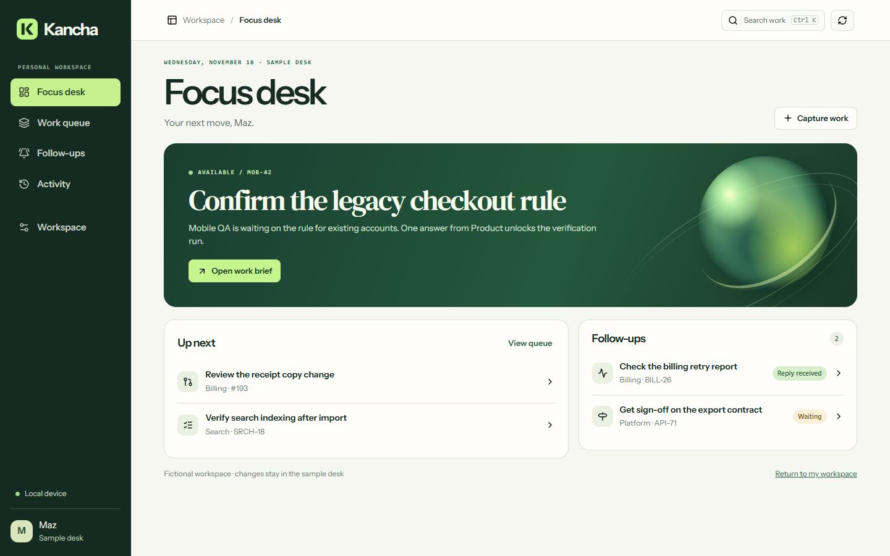

# Kancha PM

A personal project manager inside the coding agent you already use. Kancha prepares your next action, remembers where you stopped, and brings a blocker back when someone replies. Your desk runs on your computer. Teammates can answer in Jira or GitHub without installing Kancha.



## Open your desk

Install **Node.js 24 or newer**. Clone this repo and run the following commands.

```sh
git clone https://github.com/maazbin/kancha-pm.git
cd kancha-pm
npm ci --ignore-scripts
npm start -- --open
```

On Windows, double-click **Start Kancha.cmd** in the checkout. The launcher installs missing dependencies, opens the browser, and enables local notifications while the process is running. Reopening the launcher reuses an existing desk.

The personal dashboard is at **http://127.0.0.1:4317**. Choose **Explore the sample desk** to try a fictional workspace with its own database. You can also run `npm run demo -- --open` on port 4318. An empty live workspace is expected until you capture your own work or connect a source.

## Give your coding agent the PM

Run the command for your preferred host from the permanent install location.

```sh
npm run setup -- codex
# or
npm run setup -- claude
```

Setup registers a local stdio MCP server through the host's own CLI and installs the **kancha-personal-pm** skill in the user's skills directory. Restart the host and ask **“Start my day with Kancha. Show me my next action and what could unblock someone.”** The agent and dashboard can run separately and share the same database.

For another MCP client, run `npm run setup -- config` and use the printed absolute command and arguments. Import `skills/personal-pm/SKILL.md` into the client's skill mechanism if supported. If you move the checkout, register the new path. A host that uses a hosted model processes the context your agent sends it.

## Connect real work

Open **Workspace**, enter your working hours, and select only the repositories or projects you want the PM to follow. Save, then choose **Check sources now**.

| Source | Setup and behavior |
|---|---|
| GitHub | Install and sign in to the GitHub CLI with `gh auth login`. Check `gh api user --jq .login`. Enter comma-separated `owner/repo` pairs. Kancha reads assigned open issues and direct personal review requests. It checks ordinary issue and PR conversation comments on active watches. Team review requests and inline review threads can be imported through your agent. |
| Jira Cloud | Set `KANCHA_JIRA_EMAIL` and `KANCHA_JIRA_TOKEN` in the environment of the Kancha process. Use the Jira Cloud site URL and project keys. The native reader uses a site-compatible API token and queries issues assigned to the current account. Names or account IDs can identify a watched issue commenter. Scoped cloud-ID gateway tokens can use your host's connector instead. |
| Existing agent integrations | The skill can import assigned work and permitted passages from your existing Jira, GitHub, document, email, messaging, support, and monitoring connectors. It reuses a stable external key when updating an item. Host-only sources refresh when an authorized coding session reads them. |
| Local checkout | Set an absolute checkout directory. A work brief reads the current branch and commit. Save a private checkpoint with the file or fixture to resume. |
| Documents and reported alerts | Choose **Attach** inside a work brief to save an excerpt and optional link. Use an approved source for each excerpt. Review the source before treating a reported symptom as a confirmed cause. |

Kancha uses your existing GitHub CLI credential storage. Supply Jira secrets through your process environment or your usual secret manager. Credentials are excluded from the dashboard configuration and database. Background polling needs its own available source credentials. Signing in to a coding host alone does not authenticate an independent process.

## One complete handoff

1. Open a work brief and choose **Ask / watch**. Enter the exact question, expected responder, and next check time.
2. **Start local watch** saves the follow-up privately. **Review & post question** shows the destination and text. Confirm to post once to the original Jira or GitHub thread. You can also watch an existing conversation without posting.
3. While you wait, the desk suggests other available work. Save your checkpoint before switching. Kancha checks native sources on its configured interval while the service and machine are running.
4. A new comment from the expected responder raises **Reply received**. Choose **Use this answer** or **Keep watching**. Replies are candidates until confirmed.
5. **Resume work** returns the item to focus and clears the handoff reminder. **Copy handoff** assembles the decision, source references, and private checkpoint for your coding agent. **Complete** records personal completion. Shared Jira and GitHub state stays under the team's existing workflow.

The sample desk supports this complete loop with **Simulate owner reply**. Live sources require real responses. New tickets can be delegated to your existing ticket agent or created through an explicitly authorized host connector.

## Background and local data

- `npm start -- --notify` enables native reminders. Dashboard markers also work in the browser. Quiet hours use your device's timezone. Snoozes and delivered reminders persist across sessions.
- **Windows sign-in startup** is optional. Run `./scripts/start-at-login.ps1` in PowerShell to install a user Startup shortcut. Run it with `-Remove` to remove the shortcut. No administrator access is required. On other systems run the dashboard under your own user service. Linux native delivery requires `notify-send`. macOS uses `osascript`.
- Native reminders depend on OS notification permissions and availability. When the laptop sleeps, the next successful check reconciles the latest work before delivering pending reminders. A host-only watch can raise a time reminder while source verification still needs an agent session.
- The default private data directory is `%LOCALAPPDATA%/KanchaPM` on Windows, or `$XDG_DATA_HOME/kancha-pm` (default `~/.local/share/kancha-pm`) elsewhere. `KANCHA_HOME` overrides it. Keep this value consistent between the dashboard and agent. `KANCHA_PORT` overrides the HTTP port.
- SQLite stores local work, follow-ups, evidence, checkpoints and notification receipts. Back up the data folder with all Kancha processes stopped. The server listens only on IPv4 loopback. Keep it on your personal machine. Use your OS account and disk protection for stored notes.
- Native access failures are visible in Workspace. Removed native scope and definitive access denials hide affected work and drop source excerpts. Host-imported excerpts require revalidation by the host skill. Private items are not a team-wide permissions or assignment system.

## Develop and verify

```sh
npm ci --ignore-scripts
npm test
npx playwright install chromium
npm run test:browser
```

To test with an existing Chromium browser, set `KANCHA_CHROMIUM` to its executable. Browser tests run against isolated, disposable SQLite databases. GitHub Actions runs workflow tests on Windows and Linux and the browser suite on Linux.

| Path | Purpose |
|---|---|
| `src/store.js` | SQLite storage, personal scope, guarded state transitions, focus ordering and process leases |
| `src/sources.js` | Native GitHub/Jira readers, pagination, source refreshes, reply matching and confirmed question delivery |
| `src/engine.js` | Validated operations shared by the agent and dashboard, reminders and source evidence |
| `src/mcp.js` | MCP SDK stdio server |
| `src/server.js`, `web/` | Local API and responsive dashboard |
| `src/desktop.js`, `scripts/` | Optional notification and sign-in helpers |
| `skills/personal-pm/` | Portable PM behavior for coding agents |

The native adapters use the [GitHub CLI API](https://cli.github.com/manual/gh_api), [GitHub issue comments](https://docs.github.com/en/rest/issues/comments), and [Jira Cloud issue search](https://developer.atlassian.com/cloud/jira/platform/rest/v3/api-group-issue-search/). Agent clients connect using [MCP stdio](https://modelcontextprotocol.io/specification/2025-06-18/basic/transports).
